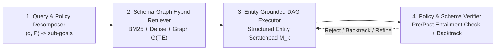

# Plan-and-Verify Agent with Schema-Grounded Tool Retrieval and Policy Guardrails for VAKRA-Advanced (SemEval-2027 Task 11)

**Advanced Natural Language Processing — Course Project Proposal**  
**Instructor:** Prof. Nagwa El-Makky  
**Submission Deadline:** Thursday, November 19, 2026  
**Project Discussion:** Saturday, November 21, 2026  

---

## 1. Key Information

* **Project Title:** Plan-and-Verify Agent with Schema-Grounded Tool Retrieval and Policy Guardrails for VAKRA-Advanced (SemEval-2027 Task 11)
* **Team Members:**
  1. **[Team Member 1 Name]** (`member1@email.edu`)
  2. **[Team Member 2 Name]** (`member2@email.edu`)
* **Project Type:** Custom Shared-Task Project ([SemEval-2027 Task 11: VAKRA-Advanced](https://sites.google.com/view/vakrasemeval2027))
* **Mentor / Course Supervision:** Supervised by Prof. Nagwa El-Makky
* **Target Subtasks:** All 4 Subtasks of VAKRA-Advanced (API Chaining, Tool Selection, Multi-Hop API Reasoning, and Multi-Hop Multi-Source Reasoning under Tool-Use Policies)

---

## 2. Research Paper Summary (Max 2 Pages)

### Bibliographical Information
* **Title:** *VAKRA: Evaluating Multi-Hop Reasoning Across APIs and Retrieval Under Tool-Use Policies*
* **Authors:** Ankita Rajaram Naik, Anupama Narasimha Murthi, Benjamin T. Elder, Siyu Huo, Praveen Venkateswaran, Abdulhamid Adebayo, Sara Rosenthal, and Danish Contractor (IBM Research)
* **Publication Venue & Year:** arXiv Preprint (`arXiv:2608.12282`), 2026 (Foundational Benchmark Paper for SemEval-2027 Task 11)
* **URLs:** Paper: https://arxiv.org/abs/2608.12282 | Code: https://github.com/IBM/vakra | Dataset: https://huggingface.co/datasets/ibm-research/VAKRA

### Background and Motivation
Deploying Large Language Model (LLM) agents in realistic enterprise workflows requires far more than generating syntactically valid JSON function calls in isolated single-turn interactions. Real-world enterprise agents must navigate thousands of heterogeneous endpoints, chain dependent API calls across 3 to 7 reasoning hops, reconcile structured tabular outputs with unstructured text documents, and strictly obey organizational tool-use policies (e.g., privacy, compliance, or source-authority restrictions). Existing benchmarks evaluate these capabilities in isolation: function-calling leaderboards such as Gorilla/BFCL focus primarily on single-turn or shallow AST schema matching, while multi-step API benchmarks such as ToolBench rely on unstable third-party web APIs or LLM-as-a-judge scoring without deterministic backend verification. Naik et al. (2026) introduce **VAKRA** (*e**V**aluating **A**PI and **K**nowledge **R**etrieval **A**gents*) to bridge this gap via a reproducible, locally executable environment that jointly evaluates large-scale tool selection, multi-hop API composition, cross-source retrieval, and policy compliance.

### Summary of Contributions
The paper makes three primary contributions:
1. **Large-Scale Executable Multi-Source Environment:** VAKRA provides **8,000+ locally hosted Python APIs** spanning **62 domains**, constructed from relational databases (adapted from BIRD-SQL, Live API-Bench, and Wikidata5M) alongside aligned unstructured document collections (derived from ClapNQ and enterprise corpora). It spans diverse API styles, from fine-grained slot-filling endpoints to complex Business Intelligence (BI) compositional APIs.
2. **Progressive Multi-Hop and Policy-Constrained Task Suite:** Evaluation is structured into progressive complexity tiers corresponding to the four SemEval-2027 Task 11 subtasks:
   * *API Chaining & Tool Selection* from large domain candidate pools ($150+$ APIs per slice).
   * *Multi-Hop Structured API Reasoning* requiring $2\text{--}7$ sequential dependent calls where intermediate outputs parameterize subsequent tool calls.
   * *Multi-Hop, Multi-Source Reasoning* ($664$ human-validated samples: $420$ unconstrained and $244$ governed by explicit natural-language tool-use policies, validated with $77\%\text{--}90\%$ inter-annotator agreement and $87\%\text{--}96\%$ high-quality ratings).
3. **Trajectory-Level Replay Verification & Empirical Bottleneck Analysis:** Because multiple execution paths can validly answer a multi-hop query, static string matching against a single reference trace penalizes valid alternative trajectories. Given query $q$, policy $\mathcal{P}$, toolset $\mathcal{T}$, and corpus $\mathcal{D}$, an agent produces trajectory $\tau = \langle (t_1, a_1, o_1), \dots, (t_K, a_K, o_K), \hat{y} \rangle$. VAKRA replays $\tau$ against live backend databases to verify both state equivalence and policy adherence:
   $$\text{Score}(\tau, q, \mathcal{P}) = \mathbb{I}\!\left[\text{ExecState}(\tau) \equiv \text{ExecState}(\tau^*)\right] \cdot \mathbb{I}\!\left[\forall k \in \{1..K\},\ (t_k, a_k) \models \mathcal{P}\right] \cdot \text{Acc}(\hat{y}, y^*)$$
   Evaluating frontier and open-weight models in a standardized **ReAct** harness, the authors show that top models reach **70.4%** accuracy on single-hop query-aligned APIs, drop to **50%–51%** on compositional BI APIs, degrade by **>50%** as hop depth increases, and plummet to **2.4%** on policy-constrained unanswerable queries. Error taxonomy reveals that failures rarely stem from syntax errors; instead, they are dominated by *language-mediated reasoning bottlenecks*: entity disambiguation across sources, schema alignment, and policy violation.

### Limitations and Critical Discussion
* **Conflation of LLM Capability with Greedy ReAct Prompting:** All baseline results rely on a fixed, single-path ReAct harness. Because ReAct interleaves local thought and action greedily without lookahead planning or backtracking, an early schema mismatch or suboptimal tool choice irreversibly derails the trajectory.
* **Passive Prompt-Only Policy Conditioning:** Natural-language policies $\mathcal{P}$ are simply prepended to the system prompt. Over long multi-hop trajectories ($>8\text{k}$ tokens of JSON payloads), models suffer from instruction forgetting, causing the severe $2.4\%$ accuracy on policy-restricted unanswerable queries.
* **Non-Interactive & Monolingual Scope:** VAKRA assumes a single-turn user instruction without interactive user clarification for ambiguous entities, and evaluates exclusively on English domains.

### Why This Paper?
We chose Naik et al. (2026) because it is the foundational paper created by the organizers of **SemEval-2027 Task 11 (VAKRA-Advanced)**. Studying it in depth provided the exact mathematical formulation of the live replay evaluator, the official ReAct baseline we must outperform, and the actionable insight that solving VAKRA requires explicit modules for *cross-source entity grounding*, *schema-graph retrieval*, and *pre-execution policy verification*.

### Wider Research Context
VAKRA bridges *compositional semantic parsing*, *retrieval-augmented generation (RAG)*, and *neuro-symbolic autonomous agents*. Where classical semantic parsing mapped text into closed-world SQL over a single schema, tool-augmented LLMs perform open-world program synthesis across heterogeneous symbolic APIs and unstructured text. Addressing VAKRA's failure modes directly advances reliable, policy-compliant language grounding across NLP.

---

## 3. Concise SOTA Survey (Max 2 Pages — Per Course Instructions)

We survey **six recent state-of-the-art papers (2024–2026)** covering large-scale tool retrieval, multi-hop API execution, and policy-constrained agent evaluation.

### Summary of Surveyed Papers
1. **VAKRA (Naik et al., 2026):** Introduces the $8,000+$ API / $62$-domain multi-source executable benchmark and ReAct baselines, showing $>50\%$ multi-hop degradation and $2.4\%$ accuracy on unanswerable policy-constrained queries.
2. **Live API-Bench (Elder et al., EACL 2026):** Transforms BIRD-SQL relational databases into $2,500+$ live Python/REST tools across $11$ domains under three abstraction styles (*SLOT*, *SEL*, *REST*). Demonstrates that models struggle heavily ($7\%\text{--}50\%$ completion) when composing fine-grained *SLOT* APIs across multiple steps.
3. **ToolLLM / ToolBench (Qin et al., ICLR 2024):** Pioneered open-world API orchestration over $16,464$ RapidAPI endpoints using a dense neural *API Retriever* and *Depth-First Search-based Decision Tree (DFSDT)* to allow backtracking from failed API calls.
4. **AnyTool (Du et al., ICML 2024):** Addresses ToolLLM's retrieval and open-loop termination flaws via a *three-tier Hierarchical API Retriever* (Meta $\rightarrow$ Category $\rightarrow$ Tool agents) and a *Self-Reflective DFSDT Solver* that audits trajectories and re-triggers retrieval on failure.
5. **$\tau$-bench (Yao et al., 2024):** Evaluates tool-agent-user interactions under strict organizational policy documents in retail and airline domains using the $\text{pass}^k$ reliability metric, proving that passive prompt conditioning fails to enforce domain policies consistently.
6. **Gorilla (Patil et al., NeurIPS 2024) & Re-Invoke (Chen et al., EMNLP 2024):** Gorilla establishes retriever-aware fine-tuning and AST/executable function-calling evaluation, while Re-Invoke introduces unsupervised synthetic query generation during indexing and multi-intent query rewriting during inference for zero-shot tool retrieval.

### Comparison Table of SOTA Approaches, Datasets, and Limitations

| Paper / System | Core Approach / Architecture | Dataset & Scale | Evaluation Metric | Key Limitations & Unresolved Issues |
| :--- | :--- | :--- | :--- | :--- |
| **VAKRA** (Naik et al., 2026) | Standardized ReAct agent over structured APIs + RAG corpus | **VAKRA**: 8,000+ live APIs, 62 domains, 664 multi-source + policy queries | Deterministic trace replay & execution state accuracy | Greedy ReAct fails on 3–7 hops (>50% drop); no policy verifier (2.4% on unanswerable policy queries). |
| **Live API-Bench** (Elder et al., EACL 2026) | ReAct & function-calling over SLOT, SEL, and REST API abstractions | **Live API-Bench**: 2,500+ live APIs across 11 BIRD-SQL domains | End-to-end DB execution match (7%–50%) | Structured APIs only; lacks unstructured document RAG and natural-language tool-use policies. |
| **ToolLLM** (Qin et al., ICLR 2024) | Dense Neural API Retriever + Depth-First Search Decision Tree (DFSDT) | **ToolBench**: 16,464 RapidAPI REST endpoints, 126k instruction traces | Pass Rate & Win Rate via LLM-as-a-Judge | Flat retriever misses multi-hop bridge tools; high token/latency cost in unconstrained DFS; non-reproducible web APIs. |
| **AnyTool** (Du et al., ICML 2024) | Hierarchical Category$\rightarrow$Tool Retriever + Self-Reflective DFSDT Solver | **AnyToolBench** & ToolBench (16,000+ APIs) | Rubrics-based Pass Rate | High multi-agent LLM call overhead; lacks explicit entity resolution between unstructured text and SQL-backed APIs. |
| **$\tau$-bench** (Yao et al., 2024) | ReAct / Function-Calling under domain policy documents | **$\tau$-bench**: Airline & Retail DB tools + policy docs | Final DB state match & $\text{pass}^k$ consistency | Small toolset (<20 tools per domain); does not address large-scale tool retrieval (8,000+ APIs) or cross-source RAG chaining. |
| **Gorilla** (2024) & **Re-Invoke** (EMNLP 2024) | Document-enriched query rewriting + Retriever-aware fine-tuning | **APIBench / BFCL / ToolBench**: 1,600–16,000 APIs | AST sub-tree match, Recall@$K$, NDCF | Optimizes single-step tool selection and syntax; does not track intermediate entity states across 3–7 dependent hops. |

### Synthesis of the Research Gap
1. **Multi-Hop Bridge Tool Retrieval:** Query-similarity retrievers (*Re-Invoke*, *AnyTool*) miss intermediate bridge tools $t_2$ in chains $t_1 \rightarrow t_2 \rightarrow t_3$ whose documentation shares few keywords with the user prompt $q$ but whose *input-output schema types* connect $t_1$'s output to $t_3$'s input.
2. **Cross-Source Entity Grounding:** Existing multi-hop agents (*ToolLLM*, *Live API-Bench*) lack a dedicated mechanism to resolve surface-form entity mentions extracted from unstructured RAG documents into canonical database primary/foreign keys required by structured APIs.
3. **Explicit Pre-Execution Policy Verification:** Both *VAKRA* and *$\tau$-bench* show that prompt-only policy conditioning fails over long contexts, motivating a dedicated **Policy Guardrail Verifier** inside the planning loop.

---

## 4. Project Description (1–2 Pages)

### 4.1 Main Goals and Scientific Question
We propose **PV-VAKRA** (*Plan-and-Verify Agent for VAKRA-Advanced*), a unified agent architecture targeting all four subtasks of SemEval-2027 Task 11. Our core scientific question is:
> *Can decomposing multi-hop tool execution into (1) Schema-Graph-Guided Hybrid Tool Retrieval, (2) DAG Planning with an Explicit Cross-Source Entity Scratchpad, and (3) Pre/Post-Execution Policy Guardrail Verification significantly overcome the hop-depth degradation (>50% drop) and policy-violation failures (2.4% unanswerable accuracy) of greedy ReAct baselines?*

* **Stretch Goals:** (i) Fine-tune an open-weight model (`Qwen2.5-7B-Instruct`) via Direct Preference Optimization (DPO) on verified vs. policy-violating execution traces, and (ii) submit our unified system to the official SemEval-2027 Task 11 leaderboard across all four subtasks.

### 4.2 NLP Tasks Addressed
We address all four subtasks of **SemEval-2027 Task 11 (VAKRA-Advanced)**:
1. **Subtask 1 (API Chaining)** & **Subtask 2 (Tool Selection):** Select the relevant subset of tools from $150+$ domain candidates (out of $8,000+$ APIs) and compose sequential/nested calls.
2. **Subtask 3 (Multi-Hop API Reasoning):** Execute $3\text{--}7$ dependent API calls by parsing intermediate JSON outputs into downstream parameters.
3. **Subtask 4 (Multi-Hop, Multi-Source Reasoning):** Combine structured API executions with unstructured document retrieval under explicit natural-language tool-use policies $\mathcal{P}$.

### 4.3 Dataset and Preprocessing
* **Dataset:** Official `ibm-research/VAKRA` dataset ($8,000+$ executable Python APIs, $62$ domains, $664$ multi-source queries with $244$ policy-constrained samples, plus official SemEval-2027 splits).
* **Preprocessing:**
  1. *API Compatibility Graph Construction:* Parse all $8,000+$ Python docstrings, argument types, and return schemas to construct a directed graph $\mathcal{G} = (\mathcal{T}, \mathcal{E})$ linking tool $t_i \rightarrow t_j$ when $t_i$'s output schema matches $t_j$'s input parameter schema.
  2. *Hybrid Indexing:* Index enriched API schemas and unstructured document chunks using BM25 + dense embeddings (`BAAI/bge-large-en-v1.5`).

### 4.4 Proposed Neural Methods and Original Contributions

1. **Sub-Query Decomposition & Schema-Graph Hybrid Retriever:** Decomposes query $q$ into atomic sub-goals $\{q_1, \dots, q_m\}$, retrieves initial candidates via hybrid scoring $s_{\text{ret}}(q_i, t) = \lambda\,\text{cos}(\mathbf{e}(q_i), \mathbf{e}(t)) + (1-\lambda)\,\text{BM25}(q_i, t)$, expands 1-hop bridge tools on $\mathcal{G}(\mathcal{T}, \mathcal{E})$, and reranks with `bge-reranker-v2-m3`.
2. **Entity-Grounded DAG Controller & Scratchpad Memory:** Maintains a structured state table $\mathcal{M}_k = \{(\text{surface\_mention}, \text{canonical\_id}, \text{source}, \text{schema\_type})\}$ that explicitly maps unstructured document entities to canonical database IDs via lookup APIs before calling downstream compositional APIs.
3. **Stepwise Schema & Policy Guardrail Verifier:** Decomposes policy $\mathcal{P}$ into atomic constraints $\{c_1, \dots, c_L\}$ and checks entailment/violation before executing $(t_k, a_k)$ and before returning $\hat{y}$, triggering local backtracking (up to $B=2$ retries) or safe abstention on policy-restricted queries.
* **Downloaded vs. Original Implementation:** We download the `IBM/vakra` environment, open-weight LLMs (`Qwen2.5-14B/32B-Instruct`, `Llama-3.3-70B-Instruct`), and `bge` checkpoints. **We implement from scratch:** (1) the API Compatibility Graph $\mathcal{G}(\mathcal{T}, \mathcal{E})$ builder and graph-expanded retriever, (2) the Entity-Grounded DAG Controller, and (3) the Pre/Post-Execution Policy Verifier.

### 4.5 Baselines
1. **Official VAKRA ReAct Baseline:** Run locally via `IBM/vakra` on identical backbone LLMs + comparison with published scores in Naik et al. (2026).
2. **Flat Dense Retrieval + ReAct:** Top-$K$ dense retrieval without Schema-Graph expansion.
3. **Ablation Models:** PV-VAKRA without Policy Verifier and PV-VAKRA without Entity Scratchpad.

### 4.6 Quantitative & Qualitative Evaluation
* **Quantitative Metrics:** (1) Trajectory Execution Accuracy (`Exec-Acc`) via VAKRA's deterministic trace replay, (2) Final Answer Accuracy / Token F1, (3) Tool Selection Recall@$K$ & F1, and (4) Policy Compliance / Abstention F1 on the $244$ policy-constrained queries.
* **Target Baseline Scores to Beat:** VAKRA's ReAct baseline achieves **70.4%** on single-hop APIs, **50%–51%** on compositional BI APIs, drops by **>50%** across hop depth, and reaches only **2.4%** on unanswerable policy-constrained queries.
* **Qualitative Analysis:** Stratified error analysis across hop counts ($2\text{--}7$ hops) and failure categories (tool selection, entity grounding, schema alignment, and policy compliance).

### 4.7 Ethical Challenges, Societal Risks, and Mitigation Strategies
Deploying autonomous tool-calling agents over enterprise databases and document stores introduces at least two critical ethical and societal risks. First, **unauthorized tool execution and policy bypass**: in real-world deployments, an agent that fails to respect natural-language compliance policies (as demonstrated by the 97.6% failure rate on unanswerable policy queries in baseline VAKRA models) could invoke restricted APIs, expose confidential employee/customer records, or execute state-mutating financial transactions without authorization. Second, **compounded cross-source hallucination in high-stakes decisions**: when an agent mislinks an ambiguous entity between an unstructured memo and a structured database across a 5-hop chain, it presents a fabricated numerical output with a false veneer of API-backed authority, risking harmful downstream decisions in healthcare, legal, or enterprise audit workflows. To mitigate these risks, we design three concrete safeguards: (1) enforcing a **strict pre-execution Policy Guardrail Verifier** that defaults to safe abstention whenever policy entailment confidence falls below a calibrated threshold $\tau_{\text{safe}}$, (2) restricting execution to **sandboxed, read-only database transactions** unless explicit human-in-the-loop confirmation is granted for state-mutating endpoints, and (3) outputting **verifiable provenance traces** that explicitly link every entity and claim in the final answer to its exact API call payload or retrieved document span.
